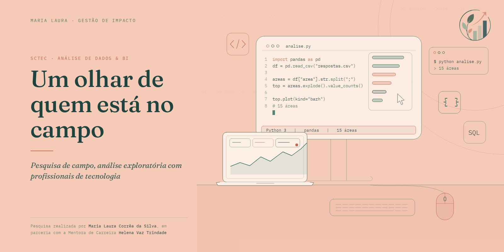

<div align="center">

# Um Olhar de Quem Está no Campo

### Pesquisa de campo · Análise exploratória · Profissionais de tecnologia

**Investigar trajetórias profissionais a partir das experiências de quem está no campo.**



<br>


<br><br>

**Status:** Análise exploratória em andamento
**Base inspecionada:** 54 respostas

</div>

---

## 01. Sobre a pesquisa

**Um Olhar de Quem Está no Campo** é uma pesquisa sobre as experiências e percepções de profissionais que atuam na área de tecnologia.

A investigação busca compreender aspectos das trajetórias profissionais, das influências que contribuíram para a escolha da área, do cotidiano de trabalho e das expectativas em relação à realidade profissional.

A proposta é olhar para os dados produzidos pelas próprias pessoas, explorando o que suas respostas revelam e quais perguntas podem surgir a partir delas.

Mais do que organizar respostas em gráficos, o projeto procura construir uma leitura contextualizada das experiências relatadas, respeitando os limites da amostra e distinguindo resultados observados de interpretações.

## 02. A pergunta que orienta o trabalho

**O que podemos compreender sobre as trajetórias profissionais em tecnologia quando escutamos quem vive essas experiências?**

Essa pergunta conduz o processo de análise.

As respostas constituem o ponto de partida para identificar recorrências, observar diferenças, formular novas perguntas e investigar possíveis relações entre as experiências relatadas.

A análise não parte de conclusões antecipadas. Os padrões precisam emergir da investigação, e as interpretações devem permanecer vinculadas às evidências disponíveis.

## 03. Objetivos

* Descrever o perfil dos participantes da pesquisa.
* Explorar os fatores mencionados como influências nas trajetórias profissionais.
* Investigar percepções sobre o cotidiano e a realidade de trabalho.
* Identificar padrões e questões que mereçam aprofundamento.
* Documentar as decisões metodológicas e as transformações realizadas nos dados.
* Explorar possibilidades de contextualização dos resultados com fontes públicas pertinentes.

## 04. A base de dados

A coleta foi realizada por meio de um formulário on-line. Com o encerramento dessa etapa, o trabalho passou a se concentrar na inspeção, preparação e exploração das respostas.

A primeira inspeção identificou:

| Característica                                                                            | Situação             |
| ----------------------------------------------------------------------------------------- | -------------------- |
| Registros identificados                                                                   | 54                   |
| Colunas no arquivo inspecionado                                                           | 17                   |
| Colunas após a identificação e exclusão da coluna inteiramente vazia na cópia de trabalho | 16                   |
| Etapa atual                                                                               | Análise exploratória |
| Documentação metodológica                                                                 | Em desenvolvimento   |

### Uma particularidade importante

O arquivo identificado durante a inspeção contém `BASELINE_36_RESPOSTAS` no nome, embora tenham sido encontrados 54 registros. A pesquisa recebeu três perguntas adicionais após a 36ª resposta.

Essa particularidade está documentada e precisa ser considerada na interpretação das variáveis. A versão e a origem da base de referência também devem ser confirmadas antes de consolidar as análises.

## 05. Percurso analítico

O trabalho está sendo desenvolvido por etapas, com registro das decisões e dos procedimentos realizados.

### Etapa 1 — Inspeção estrutural

Leitura do arquivo CSV com Python e Pandas, identificação da quantidade de registros e colunas e verificação inicial da estrutura da base.

### Etapa 2 — Preparação dos dados

Criação de uma cópia de trabalho, padronização dos nomes das colunas e identificação de campos sem conteúdo, preservando a referência aos dados originais.

### Etapa 3 — Documentação das variáveis

Construção do dicionário de dados para registrar os nomes originais das colunas, os significados das variáveis, os valores observados e as questões que ainda precisam ser conferidas no formulário original.

### Etapa 4 — Análise descritiva

Exploração inicial das respostas para compreender a composição da amostra e observar as influências relatadas nas trajetórias profissionais.

### Etapa 5 — Investigação e contextualização

Identificação de questões que possam orientar cruzamentos, aprofundamentos e, quando pertinente, buscas por dados públicos que ajudem a contextualizar os achados.

### Etapa 6 — Visualização e comunicação

Desenvolvimento gradual de visualizações e conteúdos que conectem os resultados às perguntas da pesquisa, tornando a interpretação mais acessível sem simplificar excessivamente os dados.

As etapas não são tratadas como concluídas apenas porque foram planejadas. O andamento e as pendências são registrados na documentação do projeto.

## 06. Primeiros resultados descritivos

As primeiras análises foram direcionadas ao perfil dos participantes e às influências mencionadas em suas trajetórias profissionais.

### Perfil dos participantes

A inspeção inicial identificou algumas características relevantes para contextualizar as respostas:

* **Distribuição geográfica:** 46 dos 54 participantes informaram Santa Catarina como estado, correspondendo a 85,19% da amostra.
* **Gênero:** 40 participantes são homens (74,07%), 13 são mulheres (24,07%) e uma pessoa preferiu não informar (1,85%).
* **Faixa etária:** 28 participantes têm entre 35 e 54 anos, o equivalente a 51,85% da amostra.
* **Escolaridade:** graduação e pós-graduação somam 39 participantes, correspondendo a 72,22%.

Esses resultados descrevem as pessoas que responderam à pesquisa. Não constituem estimativas da composição de todo o mercado de tecnologia.

### Influências na trajetória profissional

Na pergunta sobre os fatores que mais influenciaram a trajetória na área atual, destacaram-se:

| Influência mencionada                             | Participantes | Percentual |
| ------------------------------------------------- | ------------: | ---------: |
| Autaprendizado e curiosidade pessoal              |            38 |     70,37% |
| Formação acadêmica ou cursos                      |            34 |     62,96% |
| Transição de outra carreira                       |            22 |     40,74% |
| Busca por estabilidade ou oportunidade de mercado |            13 |     24,07% |
| Indicação ou influência da rede de contatos       |             7 |     12,96% |
| Acaso ou oportunidade inesperada                  |             7 |     12,96% |

*Observação: a pergunta permite múltiplas seleções. Portanto, os percentuais não devem ser somados como se representassem categorias mutuamente exclusivas.*

O destaque do aprendizado autônomo e da curiosidade pessoal constitui um achado descritivo que pode orientar novas perguntas. Seu significado e suas possíveis relações com outros aspectos das trajetórias ainda precisam ser investigados.

## 07. Tecnologias e ferramentas

O projeto utiliza ferramentas de programação e análise para inspecionar, organizar e explorar os dados.

| Tecnologia           | Utilização                                             |
| -------------------- | ------------------------------------------------------ |
| **Python**           | Desenvolvimento do processo de análise.                |
| **Pandas**           | Leitura, inspeção, preparação e manipulação dos dados. |
| **Jupyter Notebook** | Execução e documentação das etapas analíticas.         |
| **VS Code**          | Ambiente de desenvolvimento.                           |
| **Git e GitHub**     | Versionamento do código e organização da documentação. |

As ferramentas são escolhidas de acordo com as necessidades do trabalho. O foco está na construção de um processo analítico compreensível e rastreável, e não apenas na utilização de tecnologias.

## 08. Organização do projeto

A estrutura do repositório organiza os materiais de desenvolvimento e documentação.

```text
06_Um_olhar_de_quem_esta_no_campo/
│
├── README.md
├── .gitignore
├── imagens/
│   └── card_readme.jpeg
├── notebooks/
│   └── 01_inspecao_inicial.ipynb
└── docs/
    └── analise/
```

A estrutura poderá ser ampliada conforme o desenvolvimento da pesquisa.

Os dados originais, arquivos derivados e materiais de trabalho não são necessariamente disponibilizados publicamente. O conteúdo efetivamente publicado depende da organização vigente do repositório e dos cuidados de privacidade aplicáveis.

## 09. Rastreabilidade e responsabilidade

A documentação é parte integrante do processo de análise.

O projeto adota os seguintes princípios:

* Preservar os dados originais.
* Registrar as transformações realizadas e suas justificativas.
* Documentar as características e limitações das variáveis.
* Distinguir resultados descritivos de interpretações e hipóteses.
* Identificar as fontes utilizadas para contextualizar os resultados.
* Considerar a privacidade dos participantes e os riscos de identificação.
* Evitar conclusões que ultrapassem as evidências disponíveis.

O diário de análise registra o percurso realizado, as decisões tomadas, os resultados observados e as questões que permanecem em aberto.

## 10. Limitações da pesquisa

A pesquisa utiliza uma amostra não probabilística. Por essa razão, os resultados descrevem as respostas obtidas e não permitem, por si só, generalizações estatísticas sobre o conjunto dos profissionais de tecnologia.

A concentração de participantes em Santa Catarina também precisa ser considerada na interpretação dos resultados e em eventuais comparações com dados externos.

Além disso, algumas condições de preenchimento e categorias ainda dependem de conferência com o formulário original. Essas pendências devem ser resolvidas ou explicitadas antes de conclusões definitivas.

## 11. Sobre a pesquisadora

**Maria Laura Corrêa da Silva**
Gestão de Impacto · Análise de Dados · Visualização de Dados e Business Intelligence

Este projeto integra minha trajetória de formação e investigação na área de dados, no contexto do SCTEC/SENAI-SC.

A pesquisa conecta o aprendizado técnico à investigação de experiências reais, buscando compreender como os dados podem contribuir para leituras mais contextualizadas sobre as pessoas e suas trajetórias profissionais.

O trabalho é desenvolvido em parceria com a mentora de carreira **Helena Vaz Trindade**.

---

<div align="center">

### Dados que transformam. Impactos que geram futuro.

*Investigar os números sem perder de vista as pessoas que lhes dão significado.*

</div>
