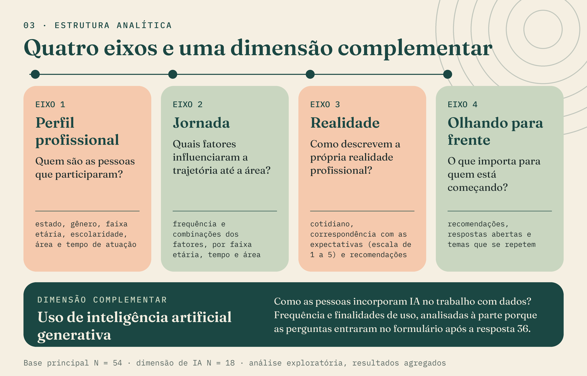

<div align="center">

# Um Olhar de Quem Está no Campo

### Trajetórias, competências e transformações no trabalho em tecnologia

**Pesquisa de campo · Análise exploratória · Profissionais de tecnologia**



**Maria Laura Corrêa da Silva**  
Análise de Dados · Visualização de Dados · Business Intelligence · Gestão de Impacto

*Novembro de 2026*

</div>

---

## 📌 Navegação

- [Sobre a pesquisa](#-sobre-a-pesquisa)
- [Pergunta orientadora](#-pergunta-orientadora)
- [Estrutura analítica](#-estrutura-analítica)
- [Metodologia e escopo](#-metodologia-e-escopo)
- [Percurso de trabalho](#-percurso-de-trabalho)
- [Resultados em síntese](#-resultados-em-síntese)
- [Produções consolidadas](#-produções-consolidadas)
- [Tecnologias e ferramentas](#-tecnologias-e-ferramentas)
- [Organização do repositório](#-organização-do-repositório)
- [Limites da pesquisa](#-limites-da-pesquisa)
- [Considerações finais](#-considerações-finais)

---

## 🎯 Sobre a pesquisa

**Um Olhar de Quem Está no Campo** é uma pesquisa exploratória sobre experiências e percepções de profissionais que atuam em diferentes frentes da área de tecnologia.

A investigação começou com uma atividade proposta no percurso formativo do SCTEC: entrevistar um profissional da área. Ao perceber que a proposta poderia alcançar outras experiências, a atividade foi ampliada para uma pesquisa de campo. Com o apoio da mentora, as perguntas inicialmente pensadas para uma entrevista foram adaptadas para um questionário, permitindo reunir diferentes percepções de quem atua no setor.

O trabalho percorreu etapas de uma investigação orientada por dados: concepção, adaptação do instrumento, mobilização de respondentes, coleta, preparação da base, análise, interpretação, contextualização, visualização e comunicação dos resultados.

## 🔎 Pergunta orientadora

> O que podemos compreender sobre as trajetórias profissionais em tecnologia quando escutamos quem vive essas experiências?

A pesquisa reúne elementos sobre o perfil dos participantes, os caminhos percorridos até a área, a maneira como descrevem seu cotidiano profissional e o que consideram importante para quem está começando.

## 🧭 Estrutura analítica

A análise foi organizada em **quatro eixos principais** e uma dimensão complementar.


| Eixo | Questão central | Conteúdos observados |
|---|---|---|
| **1. Perfil profissional** | Quem participou? | Estado, gênero, faixa etária, escolaridade, área e tempo de atuação. |
| **2. Jornada** | Quais fatores influenciaram a trajetória até a área? | Caminhos de entrada e fatores relatados pelos participantes. |
| **3. Realidade** | Como descrevem a própria realidade profissional? | Cotidiano, competências mobilizadas e correspondência com expectativas. |
| **4. Olhando para frente** | O que importa para quem está começando? | Recomendações, respostas abertas e temas recorrentes. |
| **Dimensão complementar** | Como as pessoas incorporam IA no trabalho com dados? | Frequência e finalidades de uso da Inteligência Artificial generativa. |

A dimensão de IA foi analisada separadamente porque as perguntas correspondentes foram incluídas no formulário após a resposta de número 36.

## 📐 Metodologia e escopo

- **Natureza:** pesquisa exploratória e descritiva.
- **Instrumento:** questionário on-line.
- **Base principal:** 54 participantes.
- **Dimensão complementar de IA:** 18 respondentes.
- **Tratamento:** inspeção, preparação e organização dos dados; análise quantitativa e qualitativa; construção de visualizações e sínteses interpretativas.
- **Apresentação:** resultados agregados.

A amostra é não probabilística. Os resultados descrevem as respostas obtidas e não representam estatisticamente o conjunto de profissionais de tecnologia de Santa Catarina ou do Brasil.

As perguntas de múltipla seleção permitem que uma pessoa indique mais de uma alternativa. Por isso, seus percentuais não devem ser somados como se fossem categorias exclusivas.

Na dimensão de IA, o denominador é **N=18**. As 36 respostas anteriores à inclusão dessas perguntas não indicam ausência de uso: esses participantes não receberam o bloco complementar.

## 🔄 Percurso de trabalho

O desenvolvimento da pesquisa envolveu diferentes etapas:

1. **Concepção da investigação** — transformação de uma atividade de entrevista em uma proposta de pesquisa de campo.
2. **Construção do instrumento** — adaptação das perguntas e organização dos eixos temáticos.
3. **Mobilização e coleta** — divulgação do questionário e acompanhamento das respostas.
4. **Inspeção e preparação** — reconhecimento da base, verificação de campos, consistência e organização dos dados.
5. **Análise** — exploração dos dados quantitativos e leitura temática das respostas abertas.
6. **Interpretação e contextualização** — articulação dos achados entre os eixos e diálogo com referências institucionais.
7. **Visualização e comunicação** — elaboração de gráficos, sínteses e materiais de devolutiva.

Os notebooks documentam etapas da inspeção, preparação e análise. As decisões metodológicas e interpretativas também foram registradas em documentos de apoio ao longo do processo.

## 📊 Resultados em síntese

Alguns indicadores ajudam a apresentar o recorte observado:

| Dimensão | Resultado |
|---|---:|
| Participantes que informaram Santa Catarina | **46 de 54 (85,2%)** |
| Participantes entre 35 e 54 anos | **28 de 54 (51,9%)** |
| Participantes com graduação ou pós-graduação | **39 de 54 (72,2%)** |
| Participantes que assinalaram autoaprendizado e curiosidade na trajetória | **38 de 54 (70,4%)** |
| Participantes que assinalaram resolução de problemas no cotidiano | **39 de 54 (72,2%)** |
| Participantes que assinalaram aprendizagem contínua no cotidiano | **37 de 54 (68,5%)** |
| Respondentes da dimensão complementar de IA | **18** |

Na dimensão complementar de IA, entre os 18 respondentes, 9 (50,0%) indicaram uso integrado ao fluxo de trabalho e 8 (44,4%) relataram uso diário ou quase diário.

Esses números são pontos de entrada para a leitura dos resultados. A interpretação considera os denominadores, o formato das perguntas e os limites da amostra.

## 📚 Produções consolidadas

A pesquisa resultou em dois materiais complementares, disponíveis na pasta `docs/relatorios/`.

### Atlas — Um Olhar de Quem Está no Campo

Publicação editorial que organiza os principais achados em uma narrativa visual, articulando perfil, trajetórias, cotidiano profissional, recomendações e uso de IA.

[📖 Acessar o Atlas (PDF)](docs/relatorios/Atlas_um_olhar_de_quem_esta_no_campo.pdf)

### Relatório de síntese

Documento de apoio que apresenta a introdução, o escopo metodológico, os resultados por eixo, a leitura das respostas abertas, as considerações finais e as referências contextuais.

[📄 Acessar o relatório (PDF)](docs/relatorios/Relatorio_um_olhar_de_quem_esta_no_campo_revisado.pdf)

## 🛠️ Tecnologias e ferramentas

| Ferramenta | Aplicação no projeto |
|---|---|
| **Python** | Linguagem utilizada no tratamento e na análise dos dados. |
| **Pandas** | Leitura, organização, transformação e exploração da base. |
| **NumPy** | Apoio a operações e manipulações numéricas. |
| **Matplotlib** | Construção de visualizações. |
| **Seaborn** | Exploração e composição de gráficos estatísticos. |
| **Jupyter Notebook** | Desenvolvimento documentado das etapas de inspeção e análise. |
| **Visual Studio Code** | Ambiente de desenvolvimento e organização do projeto. |
| **Git e GitHub** | Versionamento, registro das etapas e documentação do trabalho. |

## 🗂️ Organização do repositório

A estrutura abaixo representa a organização geral do projeto. Os diretórios de eixos e notebooks reúnem os materiais de análise correspondentes.

```text
06_Um_olhar_de_quem_esta_no_campo/
│
├── data/
│   ├── fonte_original/
│   └── fontes_publicas/
│
├── docs/
│   ├── analise/
│   ├── contatos/
│   ├── referencias/
│   └── relatorios/
│       ├── Atlas_um_olhar_de_quem_esta_no_campo.pdf
│       └── Relatorio_um_olhar_de_quem_esta_no_campo_revisado.pdf
│
├── eixo_complementar_ia/
├── eixo_jornada/
├── eixo_olhando_para_frente/
├── eixo_perfil_profissional/
├── eixo_realidade/
│
├── imagens/
│   ├── card_abertura.jpeg
│   ├── card_atualizacao_020926.jpeg
│   ├── card_atualizacao_230826.jpeg
│   ├── card_atualizacao_160926.jpg
│   ├── card_encerramento.jpeg
│   ├── card_readme_eixos_analiticos.png
│   └── card_readme.jpeg
│
├── materiais_apresentação/
├── notebooks/
├── .gitignore
└── README.md
```

**Observação:** a árvore é uma visão resumida dos diretórios principais. A pasta `docs/relatorios/` reúne as versões finais do Atlas e do relatório. Os diretórios `data/` e `docs/` organizam materiais de trabalho e documentação; arquivos com informações que possam identificar respondentes não devem ser disponibilizados publicamente.

## ⚖️ Limites da pesquisa

Esta investigação tem caráter exploratório, utiliza amostra não probabilística e reúne experiências de pessoas que responderam voluntariamente ao questionário. Seus resultados não devem ser generalizados para todo o setor.

As respostas abertas foram organizadas em aproximações temáticas e interpretadas de forma agregada. As sínteses são paráfrases analíticas, não citações literais nem falas atribuídas a participantes específicos.

A dimensão de IA possui base própria, com 18 respostas, e não permite inferências sobre os demais participantes. O diálogo com fontes institucionais amplia a contextualização, mas não constitui comparação estatística entre universos diferentes.

## ✨ Considerações finais

Entrei no SCTEC para aprender a trabalhar com dados. Com esta pesquisa, tive a oportunidade de experimentar esse trabalho de ponta a ponta: da concepção da investigação à comunicação dos resultados.

O percurso exigiu ferramentas, conhecimentos e decisões em diferentes momentos. Também mostrou que o trabalho de análise não se encerra na preparação da base ou na construção de gráficos. Há um caminho entre a pergunta inicial, a interpretação dos dados e a informação que chega a outras pessoas e pode produzir compreensão.

**Um Olhar de Quem Está no Campo** registra esse percurso de aprendizagem e investigação, com atenção às experiências de quem atua na área de tecnologia.

---

<div align="center">

**Pesquisa e análise:** Maria Laura Corrêa da Silva  
**Mentoria de carreira:** Helena Vaz Trindade  
**Contexto de desenvolvimento:** SCTEC · SENAI-SC

*Novembro de 2026*

</div>
