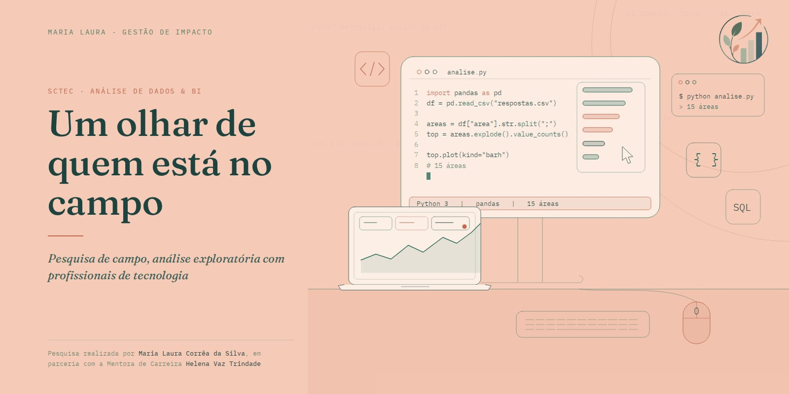

<div align="center">

# Um Olhar de Quem Está no Campo

### Pesquisa de campo · Análise exploratória · Profissionais de tecnologia

**Trajetórias, competências e transformações no trabalho em tecnologia: uma leitura exploratória em diálogo com o cenário catarinense.**



<br>


<br><br>

**Status:** análise exploratória por eixos concluída; integração analítica e contextualização em desenvolvimento  
**Base principal:** 54 respostas  
**Notebooks analíticos:** 5 — executados integralmente e revisados

</div>

---

## 01. Sobre a pesquisa

**Um Olhar de Quem Está no Campo** é uma pesquisa sobre as experiências e percepções de profissionais que atuam na área de tecnologia.

A investigação busca compreender trajetórias profissionais, fatores que influenciaram a aproximação e a entrada na área, características do cotidiano de trabalho, correspondência entre expectativas iniciais e realidade vivenciada, além das recomendações e perspectivas compartilhadas por quem já está no campo.

A pesquisa parte das respostas dos próprios participantes. O objetivo não é apenas apresentar frequências e gráficos, mas investigar recorrências, diferenças, combinações e questões que ajudem a compreender os fenômenos observados na amostra.

## 02. Direção da pesquisa

**Trajetórias, competências e transformações no trabalho em tecnologia: uma leitura exploratória em diálogo com o cenário catarinense.**

A análise considera os resultados da pesquisa como evidências exploratórias e busca, em uma etapa posterior, contextualizá-los com dados públicos e referências institucionais pertinentes ao cenário de Santa Catarina.

A amostra não é probabilística e não pretende representar estatisticamente o universo dos profissionais de tecnologia de Santa Catarina ou do Brasil. Os resultados são apresentados de forma agregada, preservando a identidade dos participantes.

### Pergunta orientadora

**O que podemos compreender sobre as trajetórias profissionais em tecnologia quando escutamos quem vive essas experiências?**

## 03. Estrutura analítica

A investigação está organizada em quatro eixos principais e uma dimensão complementar.

### Eixo 1 — Perfil profissional

**Pergunta:** Quem são os profissionais que participaram da pesquisa e quais características definem o perfil dessa amostra?

Variáveis analisadas:
- Estado;
- gênero;
- faixa etária;
- escolaridade;
- área de atuação;
- tempo de atuação em tecnologia.

A análise inclui três cruzamentos exploratórios:
- faixa etária × tempo de atuação;
- escolaridade × área de atuação;
- gênero × área de atuação.

### Eixo 2 — Jornada

**Pergunta:** Quais fatores influenciaram as trajetórias dos participantes até a área em que atuam hoje?

A análise investiga:
- frequência dos fatores de influência;
- quantidade de fatores selecionados por participante;
- combinações mais recorrentes;
- fatores de influência por faixa etária;
- fatores de influência por tempo de atuação;
- fatores de influência por área profissional.

A pergunta permitia múltiplas seleções. Por isso, os percentuais representam a proporção de participantes que assinalaram cada alternativa e não devem ser somados como categorias exclusivas.

### Eixo 3 — Realidade

**Pergunta:** Como os participantes caracterizam sua realidade profissional e que percepções expressam sobre a experiência de trabalhar na área de tecnologia?

A análise contempla:
- características presentes no cotidiano profissional;
- combinações de características selecionadas;
- correspondência entre realidade profissional e expectativas iniciais, medida em escala de 1 a 5;
- recomendações consideradas importantes para quem está começando;
- combinações de recomendações;
- recomendações por faixa etária e por tempo de atuação.

A escala de correspondência entre expectativa e realidade não é tratada como medida de satisfação profissional. A pergunta sobre recomendações permitia até três seleções por participante.

### Eixo 4 — Olhando para frente

**Pergunta:** O que os profissionais consideram importante para quem está começando na área de tecnologia e quais alertas, tendências ou recomendações desejam compartilhar a partir de sua experiência?

A análise reúne:
- recomendações selecionadas no questionário;
- combinações de recomendações;
- inspeção das respostas abertas;
- codificação temática das respostas;
- frequência dos temas principais e secundários;
- aproximações temáticas dos relatos.

A pergunta fechada sobre recomendações também é retomada no Eixo 3. No Eixo 4, ela é lida em conjunto com as respostas abertas, sem representar uma nova coleta ou um universo adicional de participantes.

Na pergunta aberta, 24 participantes registraram respostas. Uma resposta foi excluída por não apresentar conteúdo relacionado à pergunta, e 23 foram consideradas na análise temática. As manifestações são voluntárias e não representam necessariamente os 54 participantes.

### Dimensão complementar — Uso de Inteligência Artificial

**Pergunta:** Como os participantes incorporam ferramentas de inteligência artificial generativa em suas atividades profissionais relacionadas ao trabalho com dados?

A dimensão examina:
- frequência de utilização;
- finalidades de utilização.

As perguntas sobre IA foram incorporadas ao formulário após a resposta 36. Assim:
- base principal da pesquisa: **N = 54**;
- respostas válidas para a dimensão complementar de IA: **N = 18**.

Essa diferença é estrutural, decorrente da evolução do instrumento de coleta. As 36 respostas ausentes nessa dimensão não devem ser interpretadas como ausência de uso de IA. Os resultados de IA são analisados separadamente, sempre com denominador N = 18.

## 04. Resultados descritivos em destaque

Os números abaixo sintetizam resultados observados nos cinco notebooks. As perguntas de múltipla escolha permitem mais de uma seleção; nesses casos, os percentuais não representam partes exclusivas de um total de 100%.

### Perfil profissional — N = 54

- **Concentração territorial:** 46 participantes (85,2%) informaram Santa Catarina.
- **Gênero:** 40 homens (74,1%), 13 mulheres (24,1%) e uma pessoa que preferiu não informar (1,9%).
- **Faixa etária:** 28 participantes (51,9%) têm entre 35 e 54 anos.
- **Escolaridade:** graduação (22; 40,7%) e pós-graduação (17; 31,5%) somam 72,2% da amostra.
- **Tempo de atuação:** a faixa de 1 a 3 anos reúne 15 participantes (27,8%).
- **Áreas de atuação:** foram registradas 107 marcações em 15 categorias. As mais frequentes foram Desenvolvimento de Software (27), Análise de Dados/Analytics (15), Inteligência Artificial/Machine Learning (14) e Gestão de Projetos em Tecnologia (11).

### Jornada — N = 54

Os fatores mais mencionados como influência na trajetória profissional foram:
- autoaprendizado e curiosidade pessoal: 38 participantes (70,4%);
- formação acadêmica ou cursos: 34 (63,0%);
- transição de outra carreira: 22 (40,7%);
- busca por estabilidade ou oportunidade de mercado: 13 (24,1%);
- indicação ou influência da rede de contatos: 7 (13,0%);
- acaso ou oportunidade inesperada: 7 (13,0%).

A análise das escolhas também examinou quantos fatores cada participante selecionou, as combinações mais frequentes e a distribuição dos fatores por faixa etária, tempo de atuação e área profissional.

### Realidade — N = 54

No cotidiano profissional, destacaram-se:
- resolução de problemas: 39 participantes (72,2%);
- aprendizado contínuo: 37 (68,5%);
- conhecimento técnico: 26 (48,1%);
- comunicação e colaboração: 24 (44,4%);
- adaptação a mudanças: 19 (35,2%);
- gestão de prioridades: 18 (33,3%).

Na correspondência entre realidade profissional e expectativas iniciais, a nota 3 foi a mais frequente (22; 40,7%), seguida pela nota 4 (17; 31,5%) e pela nota 5 (11; 20,4%). As notas 1 e 2 reuniram quatro respostas (7,4%). As notas 4 e 5, juntas, representam 28 participantes (51,9%).

As recomendações para iniciantes mais assinaladas foram aprendizagem contínua (38; 70,4%), busca por experiência prática (30; 55,6%) e desenvolvimento de conhecimento técnico (27; 50,0%). Esses resultados são retomados no Eixo 4 junto às respostas abertas.

### Olhando para frente — N = 54; respostas abertas analisadas = 23

As recomendações fechadas mais frequentes foram aprendizagem contínua (38; 70,4%), experiência prática (30; 55,6%), conhecimento técnico (27; 50,0%) e habilidades comportamentais (25; 46,3%).

Foram identificadas 35 combinações distintas de recomendações. As dez combinações mais frequentes reuniram 29 participantes (53,7%).

Na análise das respostas abertas:
- 24 respostas foram registradas;
- uma foi excluída por não apresentar conteúdo relacionado à pergunta;
- 23 respostas foram analisadas;
- foram registradas 59 menções de temas secundários;
- essas menções foram organizadas em oito aproximações temáticas.

As aproximações mais frequentes foram **Fundamentos e conhecimentos técnicos** (14 menções; 23,7%) e **Aprendizagem e desenvolvimento profissional** (13; 22,0%). A inteligência artificial também apareceu nos relatos espontâneos: foi identificada como tema principal em cinco das 23 respostas, sob diferentes formulações.

Os percentuais das aproximações temáticas representam a distribuição das menções, não a proporção de participantes.

### Uso de Inteligência Artificial — N = 18

Na frequência de utilização:
- uso integrado ao fluxo de trabalho: 9 participantes (50,0%);
- uso diário ou quase diário: 8 (44,4%);
- uso algumas vezes por semana: 1 (5,6%).

Nas finalidades, destacaram-se:
- geração ou revisão de código/scripts: 17 (94,4%);
- redação e revisão de textos: 15 (83,3%);
- análise e interpretação de dados: 13 (72,2%);
- automação de tarefas: 11 (61,1%);
- pesquisa e síntese de informações: 11 (61,1%);
- planejamento e apoio à decisão: 9 (50,0%).

A questão permitia múltiplas seleções. Os percentuais são calculados sobre os 18 participantes e podem ultrapassar 100% quando somados.

## 05. Percurso analítico e documentação

O trabalho foi desenvolvido em notebooks específicos, com etapas de preparação, apuração, visualização, leitura analítica, síntese e encerramento.

Os cinco notebooks analíticos foram executados integralmente (*Run All*) e revisados:
1. `01_perfil_profissional_analise_aprofundada.ipynb`
2. `02_jornada_analise_aprofundada.ipynb`
3. `03_realidade.ipynb`
4. `04_olhando_para_frente.ipynb`
5. `eixo_complementar_ia.ipynb`

A execução integral foi utilizada para verificar a continuidade das células e a produção dos resultados e visualizações registrados em cada notebook.

### Próxima etapa — integração analítica

Com a análise organizada por eixos, a próxima fase é investigar o que a base revela quando seus resultados são lidos em conjunto. O trabalho seguirá esta sequência:

1. preservar e conferir a base original;
2. construir ou consolidar o dicionário de dados a partir do formulário e das colunas reais;
3. documentar decisões de tratamento, padronização e criação de variáveis;
4. integrar os principais resultados descritivos dos quatro eixos;
5. aprofundar a leitura dos campos abertos e dos padrões identificados;
6. formular perguntas analíticas e selecionar cruzamentos pertinentes;
7. definir visualizações a partir dos achados;
8. buscar dados públicos de Santa Catarina que possam dialogar com resultados específicos;
9. preparar a documentação metodológica e o README final do projeto.

A triangulação com fontes externas será seletiva. Cada aproximação deverá identificar o dado da pesquisa, a fonte externa, a citação e a leitura analítica. Quando não houver indicador comparável ou pertinente, o resultado interno poderá ser apresentado sem pareamento externo.

## 06. Diretrizes metodológicas

O projeto adota os seguintes princípios:

- preservar a base original sem alterações;
- registrar as transformações realizadas e suas justificativas;
- documentar o significado das variáveis e suas limitações;
- distinguir dado observado, interpretação e hipótese;
- considerar os denominadores específicos de cada análise;
- apresentar resultados de forma agregada;
- não identificar participantes nem expor respostas individuais;
- não estabelecer causalidade a partir de associações descritivas;
- não forçar comparações com indicadores externos incompatíveis;
- não generalizar resultados de uma amostra não probabilística.

A documentação deverá permitir compreender como os dados foram organizados e analisados, sem presumir que a base individualizada possa ser publicada. Qualquer compartilhamento futuro deverá ser avaliado separadamente, considerando o consentimento, a privacidade e o risco de reidentificação.

## 07. Tecnologias e ferramentas

| Tecnologia | Utilização |
|---|---|
| **Python** | Desenvolvimento do processo de análise. |
| **Pandas** | Leitura, inspeção, preparação e manipulação dos dados. |
| **Matplotlib** | Construção das visualizações. |
| **Jupyter Notebook** | Execução e documentação das etapas analíticas. |
| **VS Code** | Ambiente de desenvolvimento. |
| **Git e GitHub** | Versionamento do código e organização da documentação. |

As ferramentas são utilizadas de acordo com as necessidades de cada etapa. O foco está na construção de um processo analítico compreensível, verificável e rastreável.

## 08. Organização do projeto

O repositório reúne arquivos de dados, notebooks, documentação, imagens e materiais de apresentação. A estrutura é organizada por eixos e etapas de trabalho.

```text
06_Um_olhar_de_quem_esta_no_campo/
│
├── README.md
├── .gitignore
├── data/
│   ├── fonte_original/
│   ├── derivados/
│   └── fontes_publicas/
├── docs/
│   └── documentação e registros do projeto
├── notebooks/
│   ├── eixo_perfil_profissional/
│   ├── eixo_jornada/
│   ├── eixo_realidade/
│   ├── eixo_olhando_para_frente/
│   └── eixo_complementar_ia/
├── imagens/
└── materiais_apresentacao/
```

A estrutura acima apresenta a organização geral do projeto; os arquivos e subdiretórios podem evoluir conforme a documentação e a integração analítica avançarem.

Os dados originais e os arquivos de trabalho não são necessariamente disponibilizados publicamente. A presença de uma pasta no repositório não significa autorização para divulgação de seu conteúdo.

## 09. Sobre a pesquisadora

**Maria Laura Corrêa da Silva**  
Gestão de Impacto · Análise de Dados · Visualização de Dados e Business Intelligence

Este projeto integra minha trajetória de formação e investigação na área de dados, no contexto do SCTEC/SENAI-SC.

A pesquisa conecta o aprendizado técnico à investigação de experiências reais, buscando compreender como os dados podem contribuir para leituras mais contextualizadas sobre as trajetórias e transformações do trabalho em tecnologia.

O trabalho é desenvolvido com mentoria de carreira de **Helena Vaz Trindade**.

---

<div align="center">

### Dados que transformam. Impactos que geram futuro.

*Investigar os números sem perder de vista as pessoas que lhes dão significado.*

</div>
